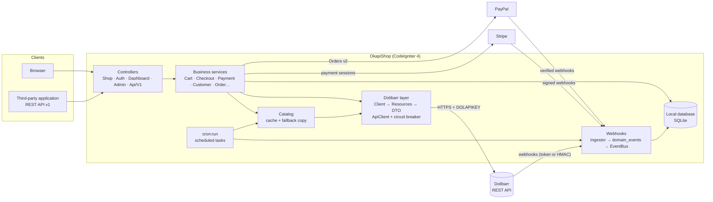

# OkapiShop

**English** · [Français](README.fr.md)

[](https://github.com/Goldron/OkapiShop/actions/workflows/ci.yml)
[](LICENSE)


Online shop **built on Dolibarr ERP/CRM**: the website is a presentation and ordering layer, and Dolibarr remains the
management system. Products, categories, prices, stock, third parties, contacts, orders, invoices, shipments and
proposals live in Dolibarr; OkapiShop reads them and writes orders through the Dolibarr REST API, with no parallel
commercial database to synchronise.

Version **1.17.1** — PHP 8.2+, CodeIgniter 4.7, SQLite, Tailwind CSS 4 / daisyUI 5.

**Full documentation: [docs/README.md](docs/README.md)** (index, reading order, concept index — in French).


---

## Contents

1. [Principles](#1-principles)
2. [Features](#2-features)
3. [Dolibarr integration in brief](#3-dolibarr-integration-in-brief)
4. [Architecture](#4-architecture)
5. [Requirements](#5-requirements)
6. [Quick installation](#6-quick-installation)
7. [Upgrade](#7-upgrade)
8. [Main commands](#8-main-commands)
9. [Tests and quality](#9-tests-and-quality)
10. [Known limitations](#10-known-limitations)
11. [Documentation](#11-documentation)

---

## 1. Principles

- **A single source of truth.** No local table for orders, customers, invoices, shipments or products. A third party,
  price, stock level or invoice changed in Dolibarr is what the shop displays (within the cache delay).
- **No double entry.** An order placed on the website is a validated Dolibarr order; the invoice and the payment of an
  online payment are created in Dolibarr.
- **Controlled degradation.** When Dolibarr is unreachable, the catalogue remains browsable from a fallback copy, order
  placement is refused and **no provisional local order is created**.
- **The browser never talks to Dolibarr.** OkapiShop alone holds the API key and checks the ownership of every order,
  invoice and document.
- **One behaviour for the web and the API.** HTML views and the v1 REST API call the same business services.

## 2. Features

| Area | Implemented features |
|---|---|
| Catalogue | Products and categories **selected** from Dolibarr (visibility and order set in the back office), capture rule (filter on Dolibarr fields), variants (Dolibarr Variants module or the *Product families* module), photos downloaded from Dolibarr, full-text search (*Search* module, FTS5) |
| Prices | Prices shown excluding or including VAT, Dolibarr multiple price levels, customer-specific prices, third-party relative discount, VAT exemption for small businesses (French *franchise en base*), intra-EU reverse charge (VAT number checked with VIES) |
| Cart | Guest (cookie) or signed in, merged at sign-in, capped at known stock (or ordering out of stock when allowed) |
| Order | Price / stock / availability revalidated in Dolibarr, shipping costs (*Shipping costs* module), acceptance of the terms and conditions, order created **and validated** in Dolibarr, idempotent |
| Payment | Cheque and bank transfer (*Payment methods* module); Stripe Checkout and PayPal (modules disabled by default); invoice and payment created in Dolibarr after a confirmed online payment (verified webhook or PayPal capture response) |
| Customer area | Profile, company (VAT number, SIREN), addresses (Dolibarr contacts), orders, invoices, shipments and their PDFs read from Dolibarr; proposals with the *Quotes* module; “Pay” button on a validated unpaid order |
| Accounts | Sign-up with email verification **before** anything is written to Dolibarr; sign-in with a password or a one-time code (OTP) sent by email |
| Content and SEO | Content pages (CKEditor), rewritten URLs, meta title and description, JSON-LD, XML sitemap per language, `robots.txt`, `llms.txt` and Markdown versions of the pages |
| Presentation | Themes (colours, fonts, compiled to CSS), configurable render points where module widgets are placed, multilingual (optional one domain per language) |
| Back office | Products, categories, pages, carts, payments, accounts, modules, email notifications, translations, scheduled tasks, activity log, Dolibarr connection diagnostics |
| API | v1 REST API (Bearer token): catalogue, cart, addresses, checkout, orders and invoices with PDFs |

**What the shop does not do**: no stock movements, no creation or change of products, categories, prices or shipments
in Dolibarr; no accounting (the `payments` table is a technical log); no automatic refunds (a `payment.refunded` event
raises a warning for manual reconciliation); one instance = one shop and one administrator account.

## 3. Dolibarr integration in brief

- **Connection**: URL and API key entered in the back office (first access, then Configuration › Dolibarr), key
  encrypted in the database; `DOLAPIKEY` header on every request.
- **Single HTTP client** (`service('dolibarrClient')`): bounded timeouts (3 s / 10 s), retries for reads only, circuit
  breaker (30 s after 5 close-together failures), typed exceptions.
- **Reads**: catalogue, variants, stock, photos, third parties, contacts, orders, invoices, shipments, proposals,
  dictionaries. **Writes**: third parties (sign-up), contacts, orders (creation, lines, contacts, validation), invoices
  and payments after an online payment.
- **Cache**: fresh and fallback (7 days) copies of the catalogue, lists rebuilt outside web requests, invalidation by
  Dolibarr webhook; no cached data at order confirmation.
- **Required Dolibarr modules**: Products, Orders, Third parties; Banks to enable Stripe, PayPal and *Payment methods*;
  Shipments and Invoices for the matching features. Checked against Dolibarr 23.0.3, no minimum version enforced.

Details (in French): [docs/dolibarr.md](docs/dolibarr.md).

## 4. Architecture



Call direction: controller → service → resource → `ApiClient`. Optional features are modules (`app/Modules/*`, 27
including the *Example* template and the *Mollie* skeleton) plugged in through filters, actions, events and render
points. Details (in French): [docs/architecture.md](docs/architecture.md).

| Component | Version (locked) |
|---|---|
| PHP | 8.2 minimum |
| CodeIgniter | 4.7.5 |
| symfony/html-sanitizer | 7.4 |
| stripe/stripe-php | 21.3 |
| dragonmantank/cron-expression | 3.6 |
| Vite | 6.4 |
| Tailwind CSS / daisyUI | 4.3 / 5.7 |
| CKEditor 5 | 48.5 |
| PHPUnit / PHPStan | 10.5 / 2.2 (level 5) |

## 5. Requirements

- Debian/Ubuntu with Nginx and PHP-FPM (sample configuration: [docs/nginx-okapishop.conf](docs/nginx-okapishop.conf));
  Apache is possible.
- PHP ≥ 8.2 with `intl`, `mbstring`, `curl`, `sqlite3` (FTS5), `openssl`, `json`, `fileinfo`, `zip`, `gd`; for the task
  manager: `pcntl`, `posix`, `proc_open`.
- Composer 2; Node.js only to rebuild the CSS/JS (compiled files are versioned).
- Dolibarr with the REST API enabled and an API key for a user with the required permissions.
- Database: SQLite. MySQL can be configured in CodeIgniter but is untested, and the built-in backup and FTS5 search are
  specific to SQLite.

Detailed list (in French): [docs/installation.md](docs/installation.md#prérequis).

## 6. Quick installation

```bash
bash install.sh -h shop.example.com -a admin -e production
```

The script installs the dependencies, writes the `.env` file (encryption key, hashed administrator password), runs the
migrations, the default data and the modules. It **does not** install the crontab and **does not** write the Dolibarr
connection. Then:

1. add the crontab line `* * * * * cd /path/to/okapishop && php spark cron:run >> writable/logs/cron.log 2>&1`;
2. open `/admin`: the **Dolibarr connection** screen asks for the URL and the key, then for the default language;
3. check: `php spark dolibarr:ping`.

Manual installation, `.env`, Nginx, permissions, webhooks and external services (in French):
[docs/installation.md](docs/installation.md).

## 7. Upgrade

From the shop folder:

```bash
sqlite3 writable/database.db ".backup 'writable/backups/before-upgrade.db'"   # backup
git pull origin master                     # or a release: git fetch --tags && git checkout v1.17.1
composer install --no-dev --optimize-autoloader
php spark migrate
php spark modules:install
```

No build step: the compiled CSS and JS files are versioned. Since 1.17.0, `public/robots.txt` is no longer versioned:
if it disappears after `git pull`, save the Robots.txt module page again or run `php spark sitemap:generate`. A
`module.json` changed by the back office (enabled module) may conflict with `git pull`: `git stash`, then `git pull`,
then `git stash pop`.

Rollback and details (in French): [docs/operations.md](docs/operations.md#mise-à-jour).

## 8. Main commands

| Command | Purpose |
|---|---|
| `php spark cron:run` | scheduled task manager (a single crontab line) |
| `php spark dolibarr:ping` | latency, Dolibarr version, circuit breaker state |
| `php spark catalog:sync [--photos]` | refresh the catalogue |
| `php spark webhooks:status`, `webhooks:replay` | event queue |
| `php spark payments:audit` | payments collected but not recorded in Dolibarr (read only) |
| `php spark modules:install` | migrations and data of the enabled modules |

Full list, logs, monitoring, backup and upgrade (in French): [docs/operations.md](docs/operations.md).

## 9. Tests and quality

```bash
vendor/bin/phpunit --no-coverage      # whole suite
composer analyse                      # PHPStan level 5
```

About 2,700 tests, with no network calls (fake Dolibarr server), their own `WRITEPATH` and an in-memory SQLite
database. `--no-coverage` is required. Details and continuous integration (in French): [docs/tests.md](docs/tests.md).

## 10. Known limitations

- One shop and one administrator account per instance, without two-factor authentication.
- Dolibarr product translations are not read: titles and descriptions are translated in the shop.
- Refunds and payment disputes: reported, reconciled manually in Dolibarr.
- No minimum Dolibarr version enforced; tested on Dolibarr 23.
- The Mollie module is a non-functional skeleton; DPD is at version 0.1.
- Installing a module from a zip archive runs its code: reserved for the administrator.

Open audit findings (in French): [docs/audits.md](docs/audits.md).

## 11. Documentation

The technical documentation is written in French.

| Document | Content |
|---|---|
| [docs/README.md](docs/README.md) | Documentation index, reading order, concept index |
| [docs/dolibarr.md](docs/dolibarr.md) | Dolibarr integration |
| [docs/architecture.md](docs/architecture.md) | Detailed technical architecture |
| [docs/installation.md](docs/installation.md) | Installation and configuration |
| [docs/operations.md](docs/operations.md) | Operations and maintenance |
| [docs/security.md](docs/security.md) | Security |
| [docs/api.md](docs/api.md) | v1 REST API |
| [docs/webhooks.md](docs/webhooks.md) | Webhooks and event queue |
| [docs/tests.md](docs/tests.md) | Tests and quality |

